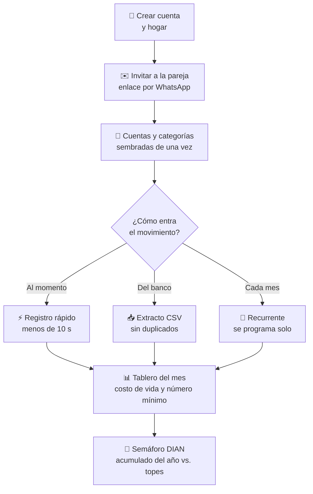
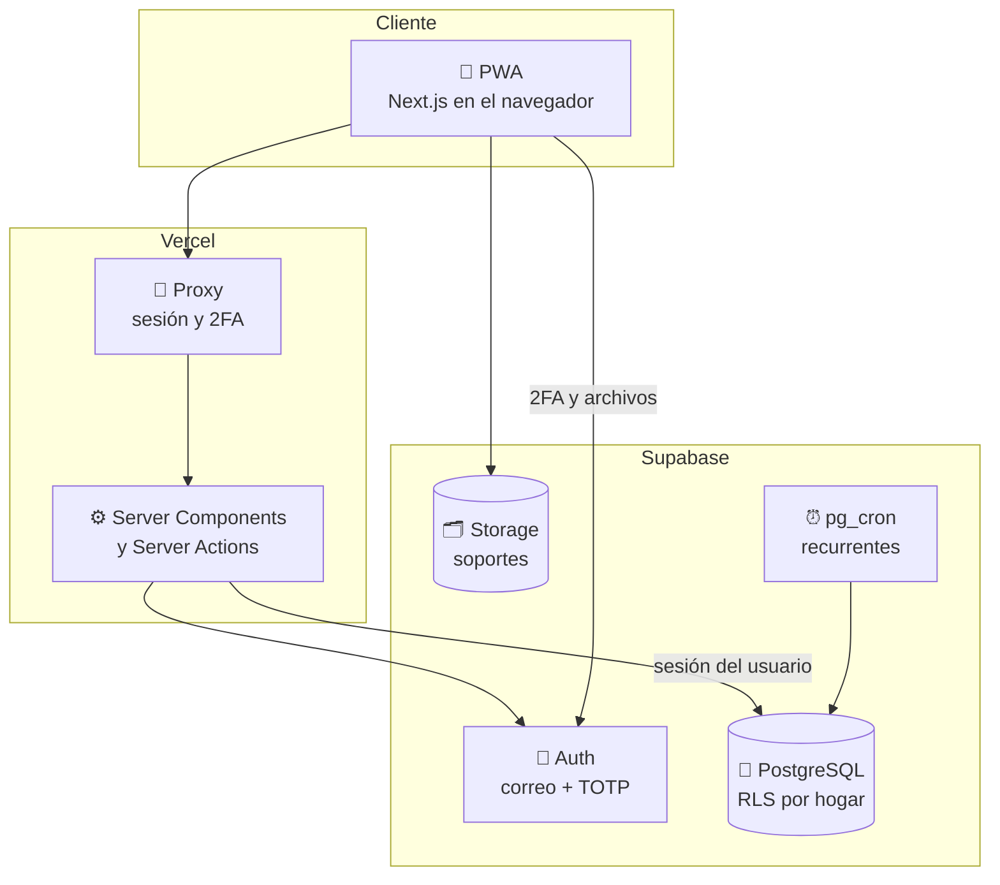

<div align="center">

# 🏠 My House

### Las finanzas del hogar en orden: gastos, costo de vida y renta sin sorpresas

Registra ingresos y gastos en segundos desde el celular, conoce cuánto cuesta vivir cada mes
y llega a la declaración de renta con todo clasificado y el semáforo DIAN a la vista.


[Qué es](#-qué-es-my-house) ·
[Funciones](#-funciones) ·
[Cómo funciona](#-cómo-funciona) ·
[Stack](#-stack) ·
[Empezar](#-empezar-en-4-pasos) ·
[Estructura](#-estructura-del-repositorio) ·
[Estado](#-estado-del-proyecto) ·
[Documentación](#-documentación)

</div>

---

## 🎯 Qué es My House

**My House** es una webapp instalable (PWA) para que un hogar, por ejemplo una pareja con hijos, registre y
categorice su dinero. Empieza como herramienta de una familia y está construida **multi-hogar desde el
día uno**, para abrirse como SaaS sin reescribir.

- **Para el día a día:** registrar un gasto (monto, categoría y cuenta) en menos de 10 segundos, importar
  el extracto del banco y dejar que los pagos fijos se programen solos.
- **Para decidir:** el costo de vida del mes, gastos fijos frente a variables, costo por persona y el
  **número mínimo del hogar** (lo que se necesita sí o sí cada mes).
- **Para la DIAN:** el acumulado del año de cada persona contra los topes para declarar renta, con el
  porcentaje alcanzado, y los movimientos etiquetados para el formulario.

Interfaz en español, locale `es-CO`, pesos colombianos con punto de miles. El módulo tributario es
intercambiable por país; Colombia es el primero.

## ✨ Funciones

<table>
<tr>
<td width="50%" valign="top">

### 💸 Movimientos
- **Registro rápido** desde el botón central: teclado numérico, categorías frecuentes y última cuenta usada.
- Ingresos, gastos y **transferencias** entre cuentas (el pago de la tarjeta no se cuenta dos veces).
- Cuentas de **banco, efectivo y tarjeta** con saldo calculado.
- **Categorías en árbol de dos niveles**: fijas o variables, esenciales o no.
- Etiquetas tributarias (rentas de trabajo, medicina prepagada, intereses de vivienda, GMF…).

</td>
<td width="50%" valign="top">

### 📥 Importar y automatizar
- **Extractos CSV** con mapeo de columnas que se recuerda por cuenta.
- **Detección de duplicados**, también cuando se cruzan extractos que se solapan.
- **Deshacer una importación** completa en un clic.
- **Gastos recurrentes** (arriendo, colegio, servicios) que generan los movimientos programados del mes.

</td>
</tr>
<tr>
<td valign="top">

### 📊 Tablero del mes
- Ingresos, gastos **fijos frente a variables** y gasto por categoría.
- **Costo por persona**, contando a los dependientes.
- **Número mínimo del hogar:** fijos + variables esenciales + cuota de imprevistos (configurable).
- Pagos programados pendientes por confirmar.

</td>
<td valign="top">

### 🚦 Semáforo DIAN
- Acumulado del año **por persona** contra cada tope para declarar: patrimonio bruto, ingresos,
  consumos con tarjeta, compras y consignaciones.
- Topes guardados en **UVT** y convertidos a pesos con la UVT del año (2025: $49.799 · 2026: $52.374).
- Verde por debajo del 70 %, amarillo del 70 % al 99 % y rojo desde el 100 %.

</td>
</tr>
<tr>
<td valign="top">

### 👨‍👩‍👧 Hogar compartido
- Invitación por **enlace para compartir por WhatsApp**: la otra persona crea su cuenta y entra al hogar.
- Roles: **administrador**, **editor** y **contador** (solo lectura).
- Hijos y otras personas a cargo como **dependientes**, sin acceso a la app.

</td>
<td valign="top">

### 🛡️ Seguridad
- **Aislamiento por hogar con Row Level Security** en todas las tablas, comprobado con pruebas.
- **Llaves foráneas compuestas** `(id, household_id)`: ninguna fila puede apuntar a datos de otro hogar.
- **Verificación en dos pasos (TOTP)** exigida al ingresar cuando está activa.
- Soportes (facturas, certificados) en un bucket privado, separados por carpeta de hogar.
- Dinero en **enteros**, nunca `float`.

</td>
</tr>
</table>

## 🔄 Cómo funciona



## 🧱 Stack

| Capa | Tecnología |
| --- | --- |
| **WebApp** | Next.js 16 (App Router, Cache Components, Server Actions) · React 19 · TypeScript estricto · Tailwind 4 |
| **Datos** | Supabase: PostgreSQL 17 con Row Level Security por `household_id` · migraciones SQL versionadas |
| **Autenticación** | Supabase Auth: correo + contraseña y TOTP (2FA) · sesión con `@supabase/ssr` |
| **Archivos** | Supabase Storage, bucket privado `soportes` |
| **Procesos programados** | `pg_cron` en Postgres (generación diaria de recurrentes) |
| **Validación** | Zod 4 · CSV con Papa Parse en el navegador |
| **Calidad** | Vitest (unitarias + aislamiento RLS contra Postgres real) · ESLint · `tsc` |
| **Despliegue previsto** | Vercel + Supabase Cloud |

### Arquitectura



La autorización vive en la base de datos: la app consulta con la sesión del usuario y **RLS decide qué
filas existen para él**. El proxy solo hace chequeos optimistas (sesión y 2FA) para redirigir.

## 🚀 Empezar en 4 pasos

> Requisitos: **Docker** y **Node 24**. Supabase local necesita unos 10 GB libres de disco para sus imágenes.

```bash
# 1. Dependencias
npm install

# 2. Supabase local (Postgres, Auth, Storage y correo de pruebas) + migraciones
npm run db:start

# 3. Variables de entorno: copie .env.example a .env.local y complete con la salida de
npx supabase status -o env   # API_URL, ANON_KEY y SERVICE_ROLE_KEY

# 4. WebApp
npm run dev
```

Abra <http://localhost:3000>, cree una cuenta y luego su hogar. En local no se exige confirmar el correo;
los correos de prueba se ven en Mailpit (<http://127.0.0.1:54324>).

Para la 2FA sirve cualquier app TOTP (Google Authenticator, Microsoft Authenticator, 1Password…).

## 📁 Estructura del repositorio

```text
My House/
├── src/
│   ├── app/
│   │   ├── (auth)/              Ingresar, registro y verificación en dos pasos
│   │   ├── (app)/               Pantallas con sesión: tablero, movimientos, registro rápido, DIAN, ajustes
│   │   ├── onboarding/          Crear el hogar
│   │   ├── invitacion/[token]/  Aceptar una invitación
│   │   └── auth/confirmar/      Enlace de confirmación de correo
│   ├── components/              Componentes de interfaz compartidos
│   ├── lib/
│   │   ├── supabase/            Clientes servidor/navegador y tipos generados de la BD
│   │   ├── sesion.ts            Capa de acceso: usuario, miembro y hogar del request
│   │   ├── dinero/              Formato y lectura de pesos (es-CO)
│   │   ├── fechas/              Fechas ISO con "hoy" en hora de Bogotá
│   │   ├── finanzas/            Costo de vida y número mínimo
│   │   ├── importacion/         CSV, mapeo de columnas y duplicados
│   │   ├── impuestos/           Jurisdicciones tributarias (co/)
│   │   └── ingesta/             Punto único para crear movimientos (manual, CSV, recurrente…)
│   └── proxy.ts                 Sesión y exigencia de 2FA
├── supabase/
│   ├── migrations/              Esquema, RLS, funciones, pg_cron y Storage
│   ├── seed.sql                 Datos solo para desarrollo
│   └── config.toml              Supabase local (TOTP activo)
├── tests/rls/                   Aislamiento entre hogares contra Postgres real
├── CLAUDE.md                    Contexto, convenciones, comandos y decisiones del proyecto
└── .env.example                 Variables de entorno
```

## 📊 Estado del proyecto

**Fase 1 (MVP de una familia), en construcción.**

| # | Incremento | Estado |
| --- | --- | :---: |
| 0 | Andamiaje: Next.js, Tailwind, Vitest, Supabase local | ✅ |
| 1 | Esquema multi-hogar, RLS y prueba de aislamiento | ✅ |
| 2 | Dinero y fechas en es-CO | ✅ |
| 3 | Autenticación, 2FA, crear hogar e invitaciones | ✅ |
| 4 | PWA instalable | ✅ |
| 5 | Cuentas y categorías | ✅ |
| 6 | Movimientos y registro rápido | ✅ |
| 7 | Gastos recurrentes | ⏳ |
| 8 | Importación de extractos CSV | ⏳ |
| 9 | Tablero del mes | ⏳ |
| 10 | Semáforo DIAN | ⏳ |
| 11 | Cierre y despliegue (Vercel + Supabase Cloud) | ⏳ |

**Después de la Fase 1:** lectura de facturas con IA (OCR), registro por WhatsApp, pronóstico de gastos,
planes y suscripciones, y conexión bancaria automática. El código ya deja los puntos de entrada listos.

## ✅ Calidad

- **Pruebas unitarias** de los cálculos: formato y lectura de montos, fechas, redirecciones seguras; luego
  número mínimo, topes UVT y duplicados de importación.
- **Prueba de aislamiento contra Postgres real:** dos usuarios del mismo hogar ven lo mismo, el contador no
  escribe, y otro hogar no puede leer, escribir, referenciar, mover filas, ver reportes, usar invitaciones
  ajenas ni descargar soportes.
- Cada incremento se cierra con lint limpio, tipos sin errores, pruebas en verde y un commit descriptivo.

```bash
npm run check      # lint + tipos + pruebas unitarias
npm run test:rls   # aislamiento entre hogares (necesita npm run db:start)
npm run build      # build de producción
```

## 📚 Documentación

| Documento | Contenido |
| --- | --- |
| [CLAUDE.md](CLAUDE.md) | Contexto del proyecto, convenciones, comandos, decisiones y problemas conocidos del entorno local |
| [supabase/migrations/](supabase/migrations/) | Modelo de datos, políticas RLS y funciones, comentados |
| [.env.example](.env.example) | Variables de entorno y dónde obtener cada una |

---

<div align="center">

Hecho en Colombia 🇨🇴 por **Jaider Riascos** · © 2026 My House · Todos los derechos reservados

</div>
