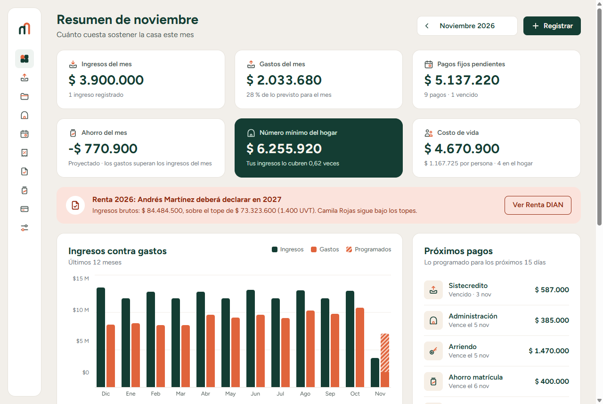
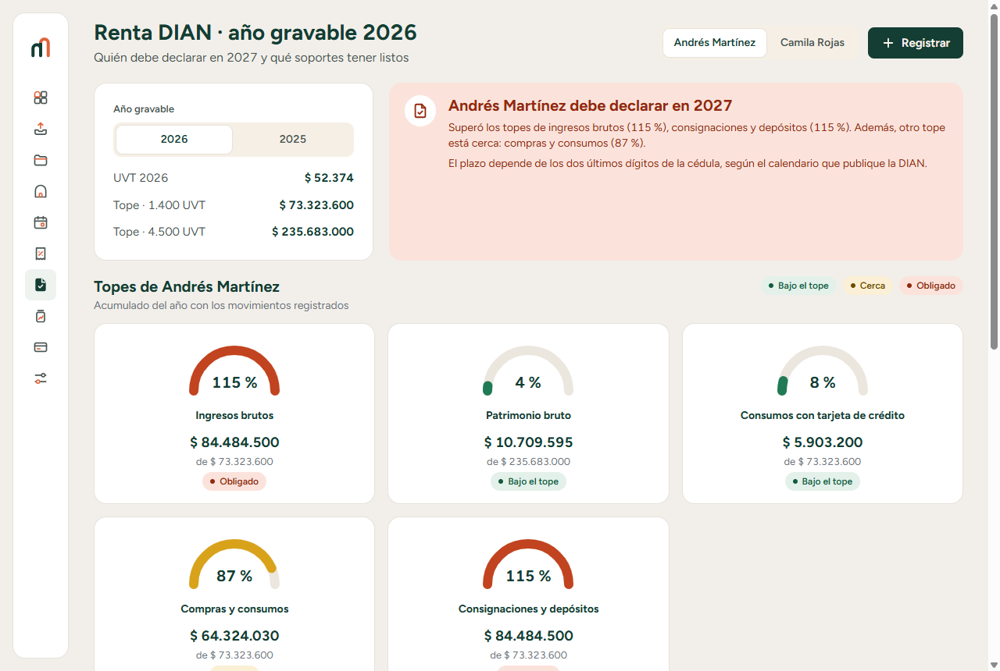
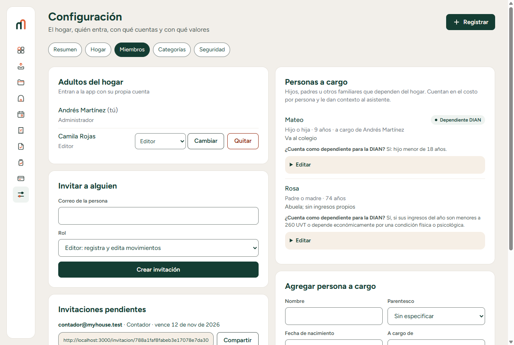
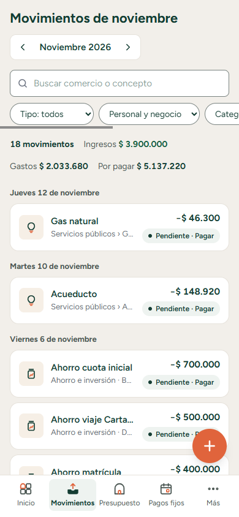
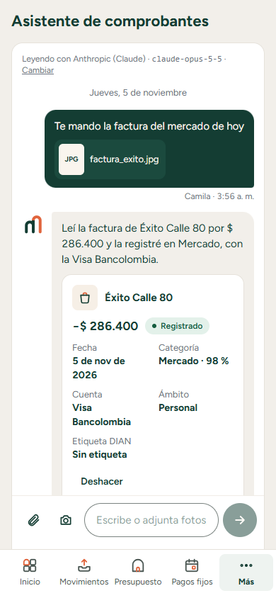
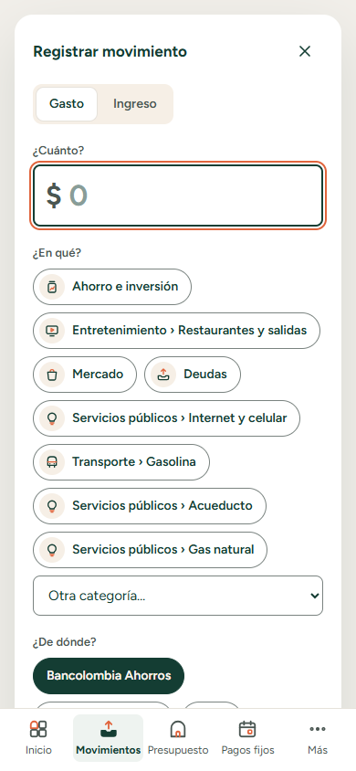
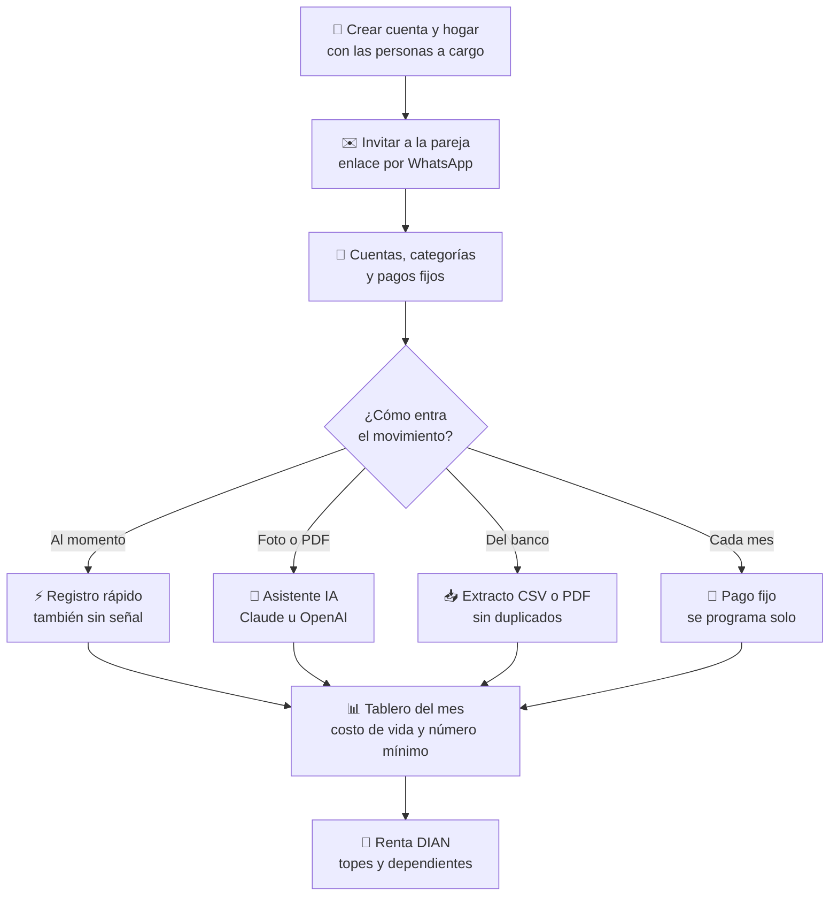
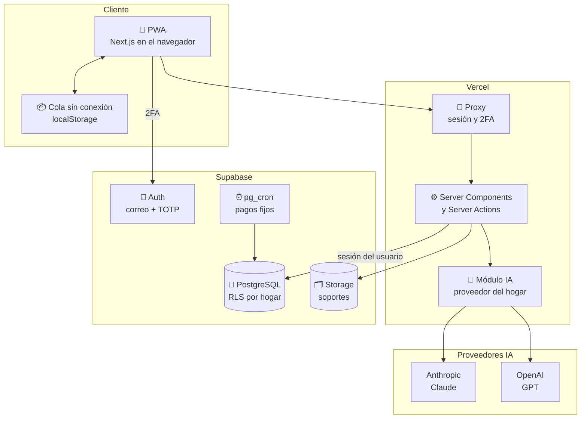

<div align="center">

# 🏠 My House

### Las finanzas del hogar en orden: gastos, costo de vida y renta sin sorpresas

Registra ingresos y gastos en segundos desde el celular (o mándale la foto de la factura al asistente),
conoce cuánto cuesta vivir cada mes y llega a la declaración de renta con todo clasificado y el semáforo DIAN a la vista.

[](https://github.com/Jaider45/My-House/actions/workflows/ci.yml)


[Qué es](#-qué-es-my-house) ·
[Funciones](#-funciones) ·
[Capturas](#-capturas) ·
[Cómo funciona](#-cómo-funciona) ·
[Stack](#-stack) ·
[Empezar](#-empezar-en-5-pasos) ·
[Estructura](#-estructura-del-repositorio) ·
[Estado](#-estado-del-proyecto) ·
[Documentación](#-documentación)

</div>

---

## 🎯 Qué es My House

**My House** es una webapp instalable (PWA) para que un hogar, por ejemplo una pareja con hijos, registre y
categorice su dinero. Empieza como herramienta de una familia y está construida **multi-hogar desde el
día uno**, para abrirse como SaaS sin reescribir.

- **Para el día a día:** registrar un gasto en menos de 10 segundos (también sin señal), mandarle al asistente
  la foto de la factura, importar el extracto del banco en CSV o PDF y dejar que los pagos fijos se programen solos.
- **Para decidir:** el costo de vida del mes, gastos fijos frente a variables, costo por persona, presupuesto
  por categoría, deudas, metas de ahorro y el **número mínimo del hogar** (lo que se necesita sí o sí cada mes).
- **Para la DIAN:** el acumulado del año de cada persona contra los topes para declarar renta, los movimientos
  etiquetados para el formulario y las **personas a cargo** que cada quien reporta como dependientes.

Interfaz en español (tuteo), locale `es-CO`, pesos colombianos con punto de miles. El módulo tributario es
intercambiable por país; Colombia es el primero.

## ✨ Funciones

<table>
<tr>
<td width="50%" valign="top">

### 💸 Movimientos
- **Registro rápido** desde el botón central: monto, categorías frecuentes y última cuenta usada.
- **Sin conexión:** lo que registras sin señal se guarda en el celular y se envía solo al volver, sin duplicarse.
- **Correos con la marca:** bienvenida, invitaciones, aviso de nuevo inicio de sesión, recordatorios de pago, pagos vencidos, resumen de los lunes y aviso de Renta DIAN, además de los de acceso (código, contraseña, confirmación).
- Ingresos, gastos y **transferencias** entre cuentas (el pago de la tarjeta no se cuenta dos veces).
- Ámbito **personal o negocio** (trabajo independiente), con filtro en la lista.
- Cuentas de **banco, efectivo, billetera y tarjeta** (cupo, corte y día de pago) con saldo calculado.
- **Categorías en árbol de dos niveles**: fijas o variables, esenciales o no.

</td>
<td width="50%" valign="top">

### 🤖 Asistente con IA
- **Chat de comprobantes:** fotos, PDF, capturas de Nequi/Daviplata o texto («almuerzo 25 mil con la Visa»).
- Lee comercio, total, fecha y medio de pago; **registra y categoriza**, o pregunta si falta algo.
- Si el pago ya estaba registrado, **adjunta el soporte** en lugar de duplicarlo.
- **Aprende** la categoría de cada comercio.
- **Claude (Anthropic) u OpenAI (GPT):** cada hogar elige proveedor y modelo; las llaves viven solo en el servidor.
- Usa el **contexto del hogar** (quiénes son, edades, personas a cargo) para categorizar mejor.

</td>
</tr>
<tr>
<td valign="top">

### 📥 Importar y automatizar
- **Extractos CSV y PDF** (el PDF lo lee la IA) con mapeo de columnas que se recuerda por cuenta.
- **Detección de duplicados**, también cuando se cruzan extractos que se solapan.
- **Deshacer una importación** completa en un clic.
- **Pagos fijos** (arriendo, colegio, servicios) que generan los movimientos programados del mes.

</td>
<td valign="top">

### 📊 Tablero, presupuesto y metas
- Ingresos, gastos **fijos frente a variables**, gráfico de 12 meses y próximos pagos.
- **Costo por persona**, contando a las personas a cargo.
- **Número mínimo del hogar:** fijos + variables esenciales + cuota de imprevistos (configurable).
- **Presupuesto** por categoría con pronóstico de cierre, **deudas** con su avance y **metas de ahorro**.

</td>
</tr>
<tr>
<td valign="top">

### 🚦 Renta DIAN
- Acumulado del año **por persona** contra cada tope para declarar: patrimonio bruto, ingresos,
  consumos con tarjeta, compras y consignaciones.
- Topes guardados en **UVT** y convertidos a pesos con la UVT del año (2025: $49.799 · 2026: $52.374).
- Verde por debajo del 70 %, amarillo del 70 % al 99 % y rojo desde el 100 %.
- **Dependientes:** orientación de quién cuenta (art. 387 E.T.) y topes de la deducción en pesos.

</td>
<td valign="top">

### 👨‍👩‍👧 Hogar compartido
- Invitación por **enlace para compartir por WhatsApp**: la otra persona crea su cuenta y entra al hogar.
- Roles: **administrador**, **editor** y **contador** (solo lectura).
- **Personas a cargo** (hijos, padres, pareja sin ingresos) con parentesco, edad y quién las tiene a cargo.
- **Contexto del hogar** en texto libre para el asistente.

</td>
</tr>
<tr>
<td colspan="2" valign="top">

### 🛡️ Seguridad
- **Aislamiento por hogar con Row Level Security** en todas las tablas, comprobado con pruebas contra Postgres real.
- **Llaves foráneas compuestas** `(id, household_id)`: ninguna fila puede apuntar a datos de otro hogar.
- **Verificación en dos pasos (TOTP)** exigida al ingresar cuando está activa.
- **Acceso sin fricción:** ver la contraseña al escribirla, medidor de fuerza, recuperación por correo, ingreso con código de 6 dígitos o con Google, y cierre de las demás sesiones al cambiar la contraseña.
- **Captcha invisible** (Cloudflare Turnstile) y correos de acceso en español con la marca.
- Soportes en un bucket privado por hogar · llaves de IA solo en el servidor · con OpenAI se envía `store: false`.
- Dinero en **enteros**, nunca `float`.

</td>
</tr>
</table>

## 📸 Capturas

Datos de demostración (`node scripts/sembrar-demo.mjs`).

| Inicio | Renta DIAN |
| :---: | :---: |
|  |  |

| Personas a cargo |
| :---: |
|  |

| Movimientos (celular) | Asistente de comprobantes | Registro rápido |
| :---: | :---: | :---: |
|  |  |  |

## 🔄 Cómo funciona



## 🧱 Stack

| Capa | Tecnología |
| --- | --- |
| **WebApp** | Next.js 16 (App Router, Cache Components, Server Actions) · React 19 · TypeScript estricto · Tailwind 4 |
| **Datos** | Supabase: PostgreSQL 17 con Row Level Security por `household_id` · migraciones SQL versionadas |
| **Autenticación** | Supabase Auth: contraseña, código al correo, Google y TOTP (2FA) · Turnstile · el hogar, el rol y la 2FA viajan en el JWT |
| **IA** | SDK de Anthropic (Claude, salida estructurada) y de OpenAI (Responses API, JSON Schema estricto) |
| **Archivos** | Supabase Storage, bucket privado `soportes` |
| **Procesos programados** | `pg_cron` en Postgres (generación diaria de pagos fijos) |
| **Validación** | Zod 4 · CSV con Papa Parse en el navegador |
| **Calidad** | Vitest (unitarias, adaptadores de IA contra API simulada y aislamiento RLS contra Postgres real) · ESLint · `tsc` |
| **Despliegue previsto** | Vercel (`gru1`) + Supabase Cloud (São Paulo) |

### Arquitectura



La autorización vive en la base de datos: la app consulta con la sesión del usuario y **RLS decide qué
filas existen para él**. El proxy solo hace chequeos optimistas (sesión y 2FA) para redirigir, y cada acción
revisa además el rol para dar un mensaje claro.

## 🚀 Empezar en 5 pasos

> Requisitos: **Docker** y **Node 24**. Supabase local necesita unos 10 GB libres de disco para sus imágenes.

```bash
# 1. Dependencias
npm install

# 2. Supabase local (Postgres, Auth, Storage y correo de pruebas) + migraciones
npm run db:start

# 3. Variables de entorno: copia .env.example a .env.local y complétalo con la salida de
npx supabase status -o env   # API_URL, ANON_KEY y SERVICE_ROLE_KEY

# 4. (Opcional) Hogar de demostración con 12 meses de movimientos
node scripts/sembrar-demo.mjs   # andres@myhouse.test · Clave-de-prueba-123

# 5. WebApp
npm run dev
```

Abre <http://localhost:3000>, crea una cuenta y luego tu hogar. En local no se exige confirmar el correo;
los correos de prueba se ven en Mailpit (<http://127.0.0.1:54324>).

**Asistente de IA:** agrega en `.env.local` al menos una llave, `ANTHROPIC_API_KEY` u `OPENAI_API_KEY`. Con las
dos, cada hogar elige en **Configuración → Hogar → Asistente de IA** (proveedor y modelo). Sin llaves la app avisa
y todo lo demás funciona.

| Variable | Para qué |
| --- | --- |
| `ANTHROPIC_API_KEY` / `OPENAI_API_KEY` | Llaves de los proveedores (solo servidor) |
| `IA_PROVEEDOR` | Proveedor por defecto cuando hay las dos llaves (`anthropic` u `openai`) |
| `ANTHROPIC_MODEL` / `OPENAI_MODEL` | Modelo por defecto de cada proveedor (`claude-opus-5-5`, `gpt-6.1-sol`) |

Para la 2FA sirve cualquier app TOTP (Google Authenticator, Microsoft Authenticator, 1Password…).

## 📁 Estructura del repositorio

```text
My House/
├── src/
│   ├── app/
│   │   ├── (auth)/              Ingresar, registro, recuperar contraseña y verificación en dos pasos
│   │   ├── (app)/               Pantallas con sesión: inicio, movimientos, comprobantes, presupuesto,
│   │   │                        pagos fijos, deudas, renta DIAN, metas, cuentas y configuración
│   │   ├── onboarding/          Crear el hogar en 3 pasos (personas a cargo, pagos fijos, invitación)
│   │   ├── invitacion/[token]/  Aceptar una invitación
│   │   └── auth/confirmar/      Enlace de confirmación de correo
│   ├── components/              Interfaz compartida (ui/, marca, cola sin conexión)
│   ├── lib/
│   │   ├── supabase/            Clientes servidor/navegador y tipos generados de la BD
│   │   ├── sesion.ts            Capa de acceso: usuario, miembro y hogar del request (desde el JWT)
│   │   ├── ia/                  Lectura con IA: esquemas, adaptadores Anthropic/OpenAI y elección de proveedor
│   │   ├── hogar/               Configuración del hogar y personas a cargo
│   │   ├── comprobantes/        Decidir: registrar, revisar o descartar un comprobante
│   │   ├── cola/                Registros hechos sin conexión
│   │   ├── dinero/ · fechas/    Pesos es-CO y fechas con "hoy" en hora de Bogotá
│   │   ├── finanzas/            Costo de vida y número mínimo
│   │   ├── presupuesto/ · deudas/ · metas/ · recordatorios/ · recurrentes/
│   │   ├── importacion/         CSV, mapeo de columnas y duplicados
│   │   ├── impuestos/           Jurisdicciones tributarias (co/: topes y dependientes)
│   │   └── ingesta/             Punto único para crear movimientos (manual, CSV, recurrente, IA…)
│   └── proxy.ts                 Sesión y exigencia de 2FA
├── supabase/
│   ├── migrations/              Esquema, RLS, funciones, pg_cron, Storage, JWT con hogar y contexto del hogar
│   ├── seed.sql                 Datos solo para desarrollo
│   └── config.toml              Supabase local (TOTP y hook del token activos)
├── tests/rls/                   Aislamiento entre hogares, personas a cargo y recurrentes contra Postgres real
├── public/sw.js                 Service worker escrito a mano (sin datos financieros en caché)
├── scripts/                     Íconos, extractos de ejemplo y hogar de demostración
├── docs/
│   ├── DESPLIEGUE.md            Guía de despliegue
│   ├── capturas/                Imágenes de este README
│   └── ejemplos/                Extractos CSV de ejemplo (3 meses + uno solapado)
├── .github/workflows/ci.yml     Integración continua
├── CLAUDE.md                    Contexto, convenciones, comandos y decisiones del proyecto
└── .env.example                 Variables de entorno
```

## 📊 Estado del proyecto

**Fase 1 (MVP de una familia): completa en local, lista para desplegar.**

| # | Incremento | Estado |
| --- | --- | :---: |
| 0 | Andamiaje: Next.js, Tailwind, Vitest, Supabase local | ✅ |
| 1 | Esquema multi-hogar, RLS y prueba de aislamiento | ✅ |
| 2 | Dinero y fechas en es-CO | ✅ |
| 3 | Autenticación, 2FA, crear hogar e invitaciones | ✅ |
| 4 | PWA instalable | ✅ |
| 5 | Cuentas y categorías | ✅ |
| 6 | Movimientos y registro rápido | ✅ |
| 7 | Pagos fijos (recurrentes) | ✅ |
| 8 | Importación de extractos CSV | ✅ |
| 9 | Tablero del mes | ✅ |
| 10 | Semáforo DIAN | ✅ |
| 11 | Cierre: CI, autoría en BD y guía de despliegue | ✅ |
| 12 | Diseño visual My House (celular, laptop y escritorio) | ✅ |
| 13 | Velocidad (hogar en el JWT), presupuesto, deudas, metas, asistente de comprobantes e importación de PDF | ✅ |
| 14 | Contexto del hogar y personas a cargo, OpenAI como proveedor, filtro personal/negocio, registro sin conexión | ✅ |
| — | Publicar en Vercel + Supabase Cloud (requiere tus cuentas) | ⏳ [guía](docs/DESPLIEGUE.md) |

**Pendiente:** envío de recordatorios por WhatsApp, correo o notificación (las fechas y canales ya se guardan),
registro por WhatsApp, pronóstico estadístico, planes y suscripciones, y conexión bancaria automática.

## ✅ Calidad

- **Pruebas unitarias** de los cálculos: montos, fechas, número mínimo, presupuesto, deudas, metas, topes UVT,
  dependientes, duplicados de importación, decisiones del asistente, configuración del hogar y cola sin conexión.
- **Adaptadores de IA** probados con los SDK reales de Anthropic y OpenAI contra una API simulada local: qué se
  envía (archivo, esquema estricto, `store: false`), cómo se valida la respuesta y cómo se explican los errores.
- **Prueba de aislamiento contra Postgres real:** dos usuarios del mismo hogar ven lo mismo, el contador no
  escribe, un editor no cambia personas a cargo ni la configuración de IA, y otro hogar no puede leer, escribir,
  referenciar, mover filas, ver reportes, usar invitaciones ajenas ni descargar soportes.
- **CI en cada push y pull request:** lint, tipos, pruebas, build, `npm audit` de producción y las pruebas de
  aislamiento contra un Supabase real levantado en el runner.

```bash
npm run check      # lint + tipos + pruebas unitarias
npm run test:rls   # aislamiento entre hogares (necesita npm run db:start)
npm run build      # build de producción
```

## 📚 Documentación

| Documento | Contenido |
| --- | --- |
| [CLAUDE.md](CLAUDE.md) | Contexto del proyecto, convenciones, comandos, decisiones y problemas conocidos del entorno local |
| [supabase/migrations/](supabase/migrations/) | Modelo de datos, políticas RLS y funciones, comentados |
| [docs/DESPLIEGUE.md](docs/DESPLIEGUE.md) | Publicar en Supabase Cloud + Vercel, variables (incluidas las de IA), primer uso y mantenimiento |
| [.env.example](.env.example) | Variables de entorno y dónde obtener cada una |

---

<div align="center">

Hecho en Colombia 🇨🇴 por **Jaider Riascos** · © 2026 My House · Todos los derechos reservados

</div>
