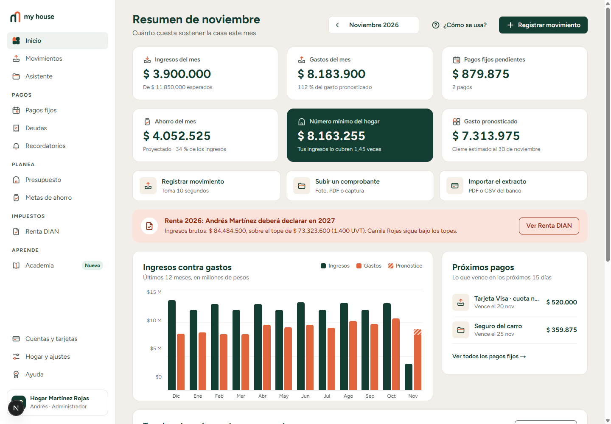
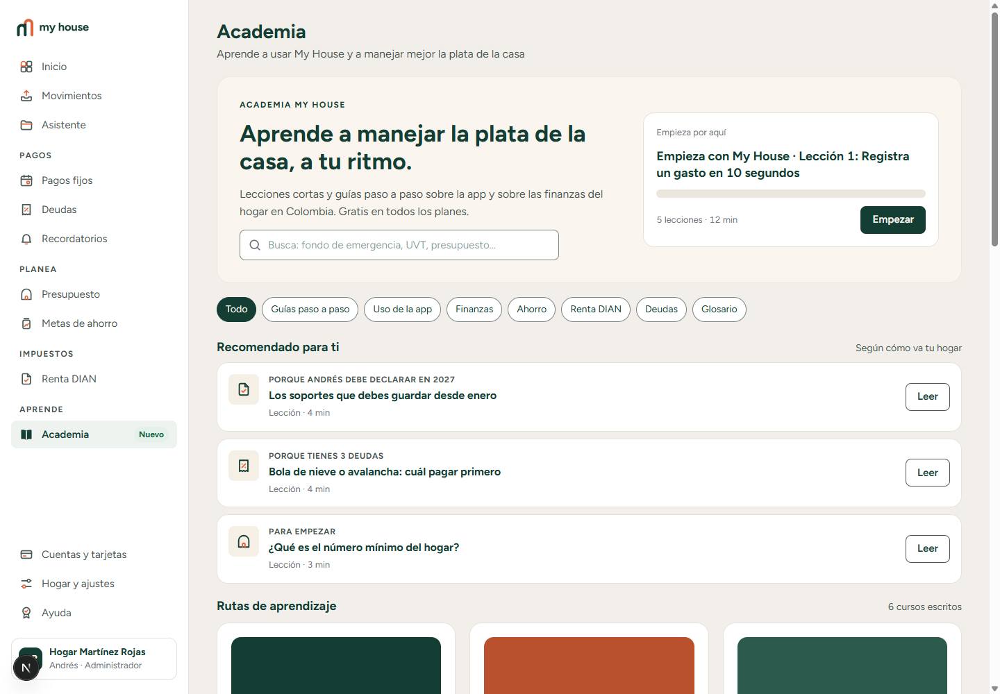
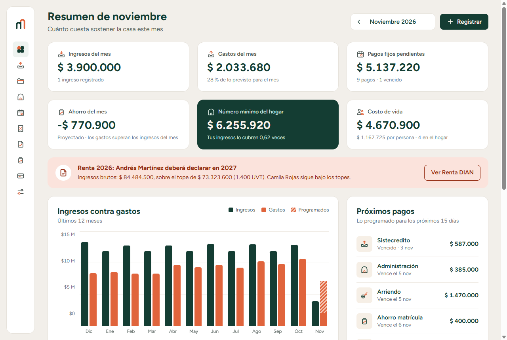
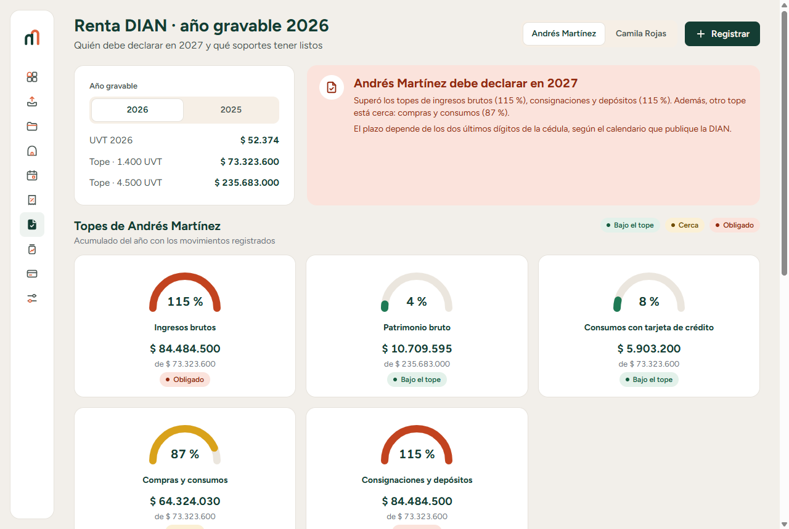
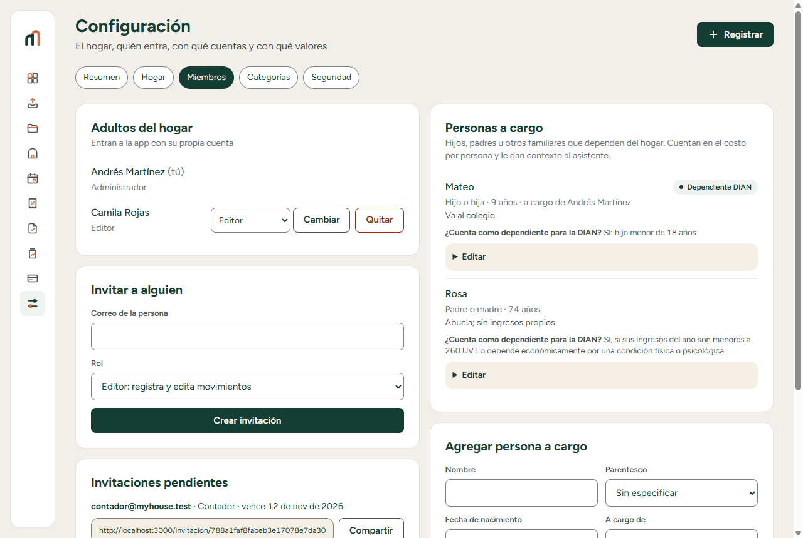
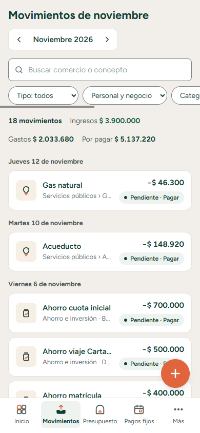
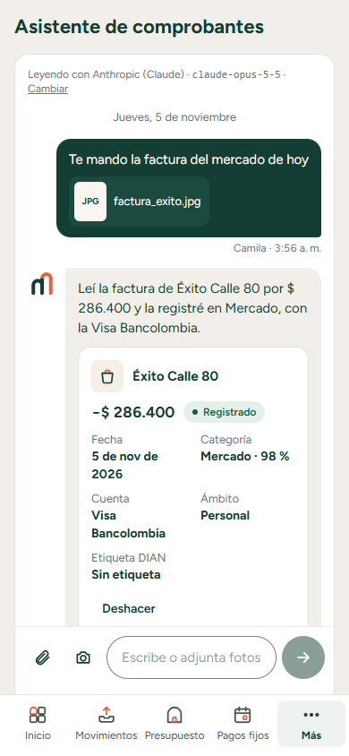
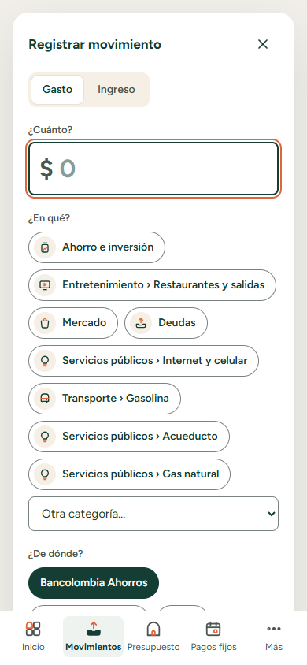
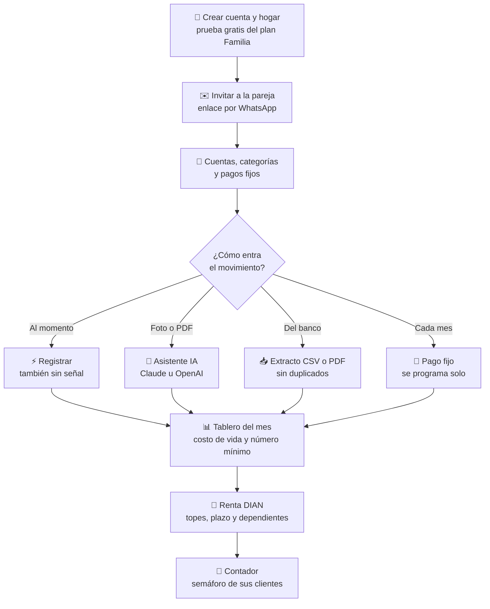
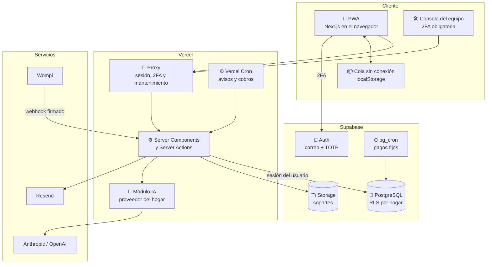

<div align="center">

# 🏠 My House

### Las finanzas del hogar en orden: gastos, costo de vida y renta sin sorpresas

Registra ingresos y gastos en segundos desde el celular (o mándale la foto de la factura al asistente),
conoce cuánto cuesta vivir cada mes y llega a la declaración de renta con todo clasificado y el semáforo DIAN a la vista.
Abierta a muchas familias y contadores, con planes, cobro en línea y una consola para el equipo.

[](https://github.com/Jaider45/My-House/actions/workflows/ci.yml)


[Qué es](#-qué-es-my-house) ·
[Novedades de esta rama](#-novedades-de-esta-rama) ·
[Funciones](#-funciones) ·
[Capturas](#-capturas) ·
[Cómo funciona](#-cómo-funciona) ·
[Stack](#-stack) ·
[Empezar](#-empezar-en-5-pasos) ·
[Estructura](#-estructura-del-repositorio) ·
[Estado](#-estado-del-proyecto) ·
[Documentación](#-documentación)

</div>

> **Rama `feat/diseno-app`**: el diseño «App» del lienzo: navegación agrupada, ventanas para crear, Registrar con tres modos y Academia. Parte de `main`; lo que cambia frente a `main` está en
> [Novedades de esta rama](#-novedades-de-esta-rama). Cuando se fusione, este README se reemplaza por uno que reúne todas las ramas.

---

## 🎯 Qué es My House

**My House** es una webapp instalable (PWA) para que un hogar, por ejemplo una pareja con hijos, registre y
categorice su dinero. Nació como herramienta de una familia y está construida **multi-hogar desde el día uno**;
hoy se abre como **SaaS** para muchas familias y para los contadores que las acompañan.

- **Para el día a día:** registrar un gasto en menos de 10 segundos (también sin señal), mandarle al asistente
  la foto de la factura, importar el extracto del banco en CSV o PDF y dejar que los pagos fijos se programen solos.
- **Para decidir:** el costo de vida del mes, gastos fijos frente a variables, costo por persona, presupuesto
  por categoría, deudas, metas de ahorro y el **número mínimo del hogar** (lo que se necesita sí o sí cada mes).
- **Para la DIAN:** el acumulado del año de cada persona contra los topes para declarar renta, el plazo según
  la cédula, los movimientos etiquetados para el formulario y las **personas a cargo** que cada quien reporta.
- **Para el negocio:** planes con límites que hace cumplir la base, cobro con Wompi, panel para contadores con
  referidos y comisiones, y una **consola** para el equipo de My House con 2FA obligatoria y auditoría.

Interfaz en español (tuteo), locale `es-CO`, pesos colombianos con punto de miles. El módulo tributario es
intercambiable por país; Colombia es el primero.

## 🆕 Novedades de esta rama

### 🎨 Diseño «App» del lienzo
- **Navegación agrupada:** Inicio, Movimientos y Asistente; **Pagos** (pagos fijos, deudas, recordatorios),
  **Planea** (presupuesto, metas), **Impuestos** y **Aprende**, con contadores de lo que está por revisar o vencido.
  En celular, barra inferior con «Más» y un botón flotante que cambia según la sección («Pago fijo», «Deuda»…).
- **Pestañas por sección:** Movimientos (Todos, Por revisar, Importar), Pagos y Planea.
- **Crear en ventanas** que abre `?nuevo=1` (deuda, abono, pago fijo, recordatorio, presupuesto, meta, aporte,
  cuenta, invitar); en celular salen como hoja desde abajo y «Atrás» las cierra.
- **Registrar con tres modos** sobre la pantalla actual: *Escribirlo* (sugiere categoría y cuenta por el concepto,
  «Lo pago después» lo deja programado), *Foto o PDF* al asistente y *Por WhatsApp* («muy pronto»).
- **Inicio** con 6 indicadores, accesos rápidos, top 5 de categorías con semáforo y Academia.
- **Academia:** 6 rutas de lecciones con repaso y «Aplícalo en My House», avance por persona, recomendaciones según
  el hogar y glosario.
- Guías «¿Cómo se usa?» ajustadas a la nueva interfaz y cuatro nuevas (meta, recordatorio, revisar, importar).

## ✨ Funciones

<table>
<tr>
<td width="50%" valign="top">

### 💸 Movimientos
- **Registro rápido** desde el botón central: monto, categorías frecuentes y última cuenta usada.
- **Registrar en una ventana** con tres modos: escribirlo, foto o PDF al asistente y WhatsApp (pronto).
- **Sin conexión:** lo que registras sin señal se guarda en el celular y se envía solo al volver, sin duplicarse.
- Ingresos, gastos y **transferencias** entre cuentas (el pago de la tarjeta no se cuenta dos veces).
- Ámbito **personal o negocio** (trabajo independiente), con filtro en la lista.
- Cuentas de **banco, efectivo, billetera y tarjeta** (cupo, corte y día de pago) con saldo calculado.
- **Categorías en árbol de dos niveles**: fijas o variables, esenciales o no.

</td>
<td width="50%" valign="top">

### 🤖 Asistente con IA
- **Chat de comprobantes:** fotos, PDF, capturas de Nequi/Daviplata o texto («almuerzo 25 mil con la Visa»).
- Lee comercio, total, fecha y medio de pago; **registra y categoriza**, o pregunta si falta algo.
- Si el pago ya estaba registrado, **adjunta el soporte** en lugar de duplicarlo.
- **Aprende** la categoría de cada comercio (y de las reglas que comparten muchos hogares).
- **Claude (Anthropic) u OpenAI (GPT):** cada hogar elige proveedor y modelo; las llaves viven solo en el servidor.
- Usa el **contexto del hogar** (quiénes son, edades, personas a cargo) para categorizar mejor.

</td>
</tr>
<tr>
<td valign="top">

### 📥 Importar y automatizar
- **Extractos CSV y PDF** (el PDF lo lee la IA) con mapeo de columnas que se recuerda por cuenta.
- **Detección de duplicados**, también cuando se cruzan extractos que se solapan.
- **Deshacer una importación** completa en un clic.
- **Pagos fijos** (arriendo, colegio, servicios) que generan los movimientos programados del mes.

</td>
<td valign="top">

### 📊 Tablero, presupuesto y metas
- Ingresos, gastos **fijos frente a variables**, gráfico de 12 meses y próximos pagos.
- **Inicio** con 6 indicadores, accesos rápidos y top 5 de categorías con semáforo.
- **Costo por persona**, contando a las personas a cargo.
- **Número mínimo del hogar:** fijos + variables esenciales + cuota de imprevistos (configurable).
- **Presupuesto** por categoría con pronóstico de cierre, **deudas** con su avance y **metas de ahorro**.

</td>
</tr>
<tr>
<td valign="top">

### 🚦 Renta DIAN
- Acumulado del año **por persona** contra cada tope para declarar: patrimonio bruto, ingresos,
  consumos con tarjeta, compras y consignaciones.
- Topes guardados en **UVT** y convertidos a pesos con la UVT del año (2025: $49.799 · 2026: $52.374).
- Verde por debajo del 70 %, amarillo del 70 % al 99 % y rojo desde el 100 %.
- **Fecha de la declaración** según los dos últimos dígitos de la cédula y correo 60, 30 y 7 días antes.
- **Dependientes:** orientación de quién cuenta (art. 387 E.T.) y topes de la deducción en pesos.

</td>
<td valign="top">

### 👨‍👩‍👧 Hogar compartido
- Invitación por **enlace para compartir por WhatsApp**: la otra persona crea su cuenta y entra al hogar.
- Roles: **administrador**, **editor** y **contador** (solo lectura).
- **Personas a cargo** (hijos, padres, pareja sin ingresos) con parentesco, edad y quién las tiene a cargo.
- **Varios hogares por persona** con selector (pensado para contadores).
- **Guías interactivas** «¿Cómo se usa?»: la pantalla se oscurece e ilumina lo que toca usar, paso a paso.

</td>
</tr>
<tr>
<td valign="top">

### 💳 Planes y cobro
- Planes **Gratis, Familia y Contador** con límites (personas, lecturas de IA, almacenamiento, metas) que **hace
  cumplir la base de datos**, no solo la pantalla.
- **Prueba gratis** una vez por hogar, **cupones** (porcentaje o meses gratis) y precios con IVA.
- **Cobro con Wompi:** solo el webhook firmado da por pagado; renovación, mora con correos los días 1, 3 y 7 y paso
  a Gratis el día 14.

</td>
<td valign="top">

### 🧮 Contadores
- **Cartera de clientes** con el semáforo DIAN de cada uno.
- **Enlace de referidos** y **comisiones** liquidadas por mes sobre los cobros de sus referidos.
- Firma verificada por el equipo; el plan Contador fija cuántos clientes atiende.

</td>
</tr>
<tr>
<td valign="top">

### 📬 Correos y avisos
- Correos con la marca: bienvenida, invitaciones, «¿Fuiste tú?» al entrar desde otro navegador, recordatorios,
  pagos vencidos, resumen de los lunes, Renta DIAN y los de acceso (código, contraseña, confirmación).
- **Avisos programados** por Vercel Cron, idempotentes y por tandas.
- **Campañas** por segmento solo a quien aceptó recibir novedades.

</td>
<td valign="top">

### 🛠️ Consola del equipo
- Equipo de My House **fuera de los hogares**: todo pasa por funciones de la base con **AAL2 exigido** y permisos por rol.
- Hogares, usuarios, planes, cobros, métricas y analítica, campañas, contadores, parámetros DIAN (borrador y
  publicar), catálogos, IA (umbral, tope de gasto y costo), soporte con SLA, Ley 1581, feature flags y mantenimiento.
- **Integraciones sin código** (Resend, Wompi, WhatsApp, Anthropic, OpenAI) con secretos en Supabase Vault.
- **Auditoría inmutable** de cada acción del equipo.

</td>
</tr>
<tr>
<td colspan="2" valign="top">

### 🛡️ Seguridad y privacidad
- **Aislamiento por hogar con Row Level Security** en todas las tablas, comprobado con pruebas contra Postgres real.
- **Llaves foráneas compuestas** `(id, household_id)`: ninguna fila puede apuntar a datos de otro hogar.
- **Verificación en dos pasos (TOTP)** exigida al ingresar cuando está activa; obligatoria en la consola.
- **Acceso sin fricción:** ver la contraseña al escribirla, medidor de fuerza, recuperación por correo, ingreso con código de 6 dígitos o con Google, y cierre de las demás sesiones al cambiar la contraseña.
- **Captcha invisible** (Cloudflare Turnstile) · CSP · `revision_seguridad()` en las pruebas exige cero hallazgos.
- **Ley 1581:** términos y política con consentimientos guardados, exportación de datos y supresión con plazos en días hábiles.
- **Acceso de soporte** a las finanzas solo con permiso del administrador del hogar, por horas y auditado.
- Soportes en un bucket privado por hogar · llaves de IA solo en el servidor · con OpenAI se envía `store: false`.
- Monitoreo con **Sentry** sin datos financieros y **página de estado** por componente.
- Dinero en **enteros**, nunca `float`.

</td>
</tr>
</table>

## 📸 Capturas

Datos de demostración (`node scripts/sembrar-demo.mjs`).

### Diseño «App»

| Inicio | Academia |
| :---: | :---: |
|  |  |

### Antes del diseño «App»

| Inicio | Renta DIAN |
| :---: | :---: |
|  |  |

| Personas a cargo |
| :---: |
|  |

| Movimientos (celular) | Asistente de comprobantes | Registro rápido |
| :---: | :---: | :---: |
|  |  |  |

## 🔄 Cómo funciona



**Cobro de un plan:** el administrador elige plan y periodo → paga en Wompi → Wompi avisa al webhook firmado →
la base extiende la suscripción. Tres días antes del vencimiento se genera la renovación; si no se paga, hay
correos de mora y el hogar pasa a Gratis el día 14 sin perder sus datos.

## 🧱 Stack

| Capa | Tecnología |
| --- | --- |
| **WebApp** | Next.js 16 (App Router, Cache Components, Server Actions) · React 19 · TypeScript estricto · Tailwind 4 |
| **Datos** | Supabase: PostgreSQL 17 con Row Level Security por `household_id` · migraciones SQL versionadas · Vault para secretos |
| **Autenticación** | Supabase Auth: contraseña, código al correo, Google y TOTP (2FA) · Turnstile · el hogar, el rol y la 2FA viajan en el JWT |
| **IA** | SDK de Anthropic (Claude, salida estructurada) y de OpenAI (Responses API, JSON Schema estricto) |
| **Pagos** | Wompi (Web Checkout y webhook firmado) |
| **Correo** | Resend (SMTP de Auth y correos de la app) · Mailpit en local |
| **Archivos** | Supabase Storage, bucket privado `soportes` |
| **Procesos programados** | `pg_cron` (pagos fijos) · Vercel Cron (avisos, cobros, campañas, retención) |
| **Monitoreo** | Sentry · Better Stack (página de estado con `/api/salud/*`) |
| **Validación** | Zod 4 · CSV con Papa Parse en el navegador |
| **Calidad** | Vitest (unitarias, adaptadores de IA contra API simulada y aislamiento RLS contra Postgres real) · ESLint · `tsc` |
| **Despliegue** | Vercel (`iad1`) + Supabase Cloud (`us-east-1`) |

### Arquitectura



La autorización vive en la base de datos: la app consulta con la sesión del usuario y **RLS decide qué
filas existen para él**. El proxy solo hace chequeos optimistas (sesión y 2FA) para redirigir, y cada acción
revisa además el rol para dar un mensaje claro. La consola no ve tablas: llama funciones `consola_*` que exigen
AAL2 y el permiso del rol.

## 🚀 Empezar en 5 pasos

> Requisitos: **Docker** y **Node 24**. Supabase local necesita unos 10 GB libres de disco para sus imágenes.

```bash
# 1. Dependencias
npm install

# 2. Supabase local (Postgres, Auth, Storage y correo de pruebas) + migraciones
npm run db:start

# 3. Variables de entorno: copia .env.example a .env.local y complétalo con la salida de
npx supabase status -o env   # API_URL, ANON_KEY y SERVICE_ROLE_KEY

# 4. (Opcional) Hogar de demostración con 12 meses de movimientos y primer superadmin de la consola
node scripts/sembrar-demo.mjs   # andres@myhouse.test · Clave-de-prueba-123
node scripts/crear-superadmin.mjs tu@correo.com "Tu nombre"

# 5. WebApp
npm run dev
```

Abre <http://localhost:3000>, crea una cuenta y luego tu hogar. En local no se exige confirmar el correo;
los correos de prueba se ven en Mailpit (<http://127.0.0.1:54324>). La consola está en <http://localhost:3000/consola>.

**Asistente de IA:** agrega en `.env.local` al menos una llave, `ANTHROPIC_API_KEY` u `OPENAI_API_KEY` (o conéctalas
en Consola → Integraciones). Sin llaves la app avisa y todo lo demás funciona.

| Variable | Para qué |
| --- | --- |
| `ANTHROPIC_API_KEY` / `OPENAI_API_KEY` | Llaves de los proveedores de IA (solo servidor) |
| `WOMPI_*` | Llaves de Wompi; sin ellas la app no ofrece pagar |
| `RESEND_API_KEY` | Envío de correos (en local se usa Mailpit) |
| `CRON_SECRET` | Protege `/api/avisos` y `/api/cobros` |
| `NEXT_PUBLIC_SENTRY_DSN` | Monitoreo de errores (opcional) |

La lista completa y dónde obtener cada una está en [.env.example](.env.example) y [docs/DESPLIEGUE.md](docs/DESPLIEGUE.md).

## 📁 Estructura del repositorio

```text
My House/
├── src/
│   ├── app/
│   │   ├── (auth)/              Ingresar, registro, recuperar contraseña y verificación en dos pasos
│   │   ├── (app)/               Pantallas con sesión: inicio, movimientos, asistente, presupuesto, pagos fijos,
│   │   │                        deudas, recordatorios, metas, renta DIAN, clientes, ayuda y configuración
│   │   │   ├── @modal/          Registrar abierto como ventana sobre la pantalla actual
│   │   │   ├── academia/        Rutas de lecciones, repaso y glosario
│   │   ├── (legal)/             Términos y política de privacidad
│   │   ├── consola/             Consola del equipo de My House (acceso con 2FA y panel)
│   │   ├── api/                 Webhooks (Wompi, WhatsApp, Resend), crons (avisos, cobros) y salud
│   │   ├── onboarding/          Crear el hogar en 3 pasos (personas a cargo, pagos fijos, invitación)
│   │   └── invitacion/[token]/  Aceptar una invitación
│   ├── components/              Interfaz compartida (ui/, guía interactiva, marca, cola sin conexión)
│   ├── lib/
│   │   ├── supabase/            Clientes servidor/navegador y tipos generados de la BD
│   │   ├── sesion.ts            Capa de acceso: usuario, miembro y hogar del request (desde el JWT)
│   │   ├── ia/ · comprobantes/  Lectura con IA y decisión: registrar, revisar o descartar
│   │   ├── finanzas/ · presupuesto/ · deudas/ · metas/ · recurrentes/
│   │   ├── impuestos/           Jurisdicciones tributarias (co/: topes y dependientes)
│   │   ├── ingesta/ · importacion/  Punto único para crear movimientos · CSV y duplicados
│   │   ├── planes/ · pagos/     Límites del plan y cobro con Wompi
│   │   ├── consola/             Permisos, ingreso y pantallas de la consola
│   │   ├── correo/ · avisos/    Plantillas de correo y avisos programados
│   │   ├── guias/               Catálogo de guías interactivas
│   │   ├── academia/ · registro/  Lecciones y sugerencias al registrar
│   │   └── integraciones/ · salud/ · legal/
│   └── proxy.ts                 Sesión, 2FA, consola y mantenimiento
├── supabase/
│   ├── migrations/              Esquema, RLS, funciones, pg_cron, Storage, planes, cobros, consola…
│   ├── templates/               Correos de Auth (generados desde src/lib/correo)
│   └── config.toml              Supabase local (TOTP y hook del token activos)
├── tests/rls/                   Aislamiento entre hogares, consola, planes y seguridad contra Postgres real
├── public/sw.js                 Service worker escrito a mano (sin datos financieros en caché)
├── scripts/                     Íconos, imágenes de correo, extractos de ejemplo, demo y primer superadmin
├── docs/                        Despliegue, roadmap SaaS, seguridad, mejoras, capturas y extractos de ejemplo
├── .github/workflows/ci.yml     Integración continua
├── CLAUDE.md                    Contexto, convenciones, comandos y decisiones del proyecto
└── .env.example                 Variables de entorno
```

## 📊 Estado del proyecto

**Fase 1 (MVP de una familia): completa.** Andamiaje, esquema multi-hogar con RLS, dinero y fechas, autenticación
con 2FA, PWA, cuentas y categorías, movimientos, pagos fijos, importación, tablero, semáforo DIAN, diseño visual,
asistente con IA, personas a cargo y registro sin conexión.

**Fase SaaS** ([roadmap](docs/ROADMAP-SAAS.md)):

| # | Fase | Estado |
| --- | --- | :---: |
| S0 | Despliegue y bases legales (faltan los datos del responsable) | 🟡 |
| S1 | Consola: acceso con 2FA, equipo y permisos, auditoría | ✅ |
| S2 | Planes y límites, hogares, usuarios | ✅ |
| S3 | Cobro con Wompi, cupones y recuperación de pagos fallidos | ✅ |
| S4 | Métricas, analítica y campañas por correo | ✅ |
| S5 | Contadores: selector de hogares, semáforo por cliente, referidos y comisiones | ✅ |
| S6 | Parámetros DIAN, catálogos e IA (umbral, tope y costo) | ✅ |
| S7 | Soporte, acceso a finanzas con permiso y Ley 1581 | ✅ |
| S8 | Sistema: feature flags, mantenimiento, versión y colas | ✅ |
| — | Guías interactivas «¿Cómo se usa?» | ✅ |

| — | Diseño «App» del lienzo (esta rama) | ✅ |

**Pendiente:** factura electrónica (falta elegir proveedor), registro y recordatorios por WhatsApp, notificaciones en el celular, conexión bancaria automática, pronóstico estadístico.

## ✅ Calidad

- **Pruebas unitarias** de los cálculos: montos, fechas, número mínimo, presupuesto, deudas, metas, topes UVT,
  dependientes, duplicados de importación, decisiones del asistente, planes, avisos, guías y correos
.
- **Adaptadores de IA** probados con los SDK reales de Anthropic y OpenAI contra una API simulada local.
- **Pruebas contra Postgres real:** aislamiento entre hogares, roles, límites de los planes, permisos de la consola
  (la matriz de TypeScript debe coincidir con la de SQL) y `revision_seguridad()` sin hallazgos.
- **CI en cada push y pull request:** lint, tipos, pruebas, build, `npm audit` de producción y las pruebas de
  aislamiento contra un Supabase real levantado en el runner.

```bash
npm run check      # lint + tipos + pruebas unitarias
npm run test:rls   # aislamiento y seguridad (necesita npm run db:start)
npm run build      # build de producción
```

## 📚 Documentación

| Documento | Contenido |
| --- | --- |
| [CLAUDE.md](CLAUDE.md) | Contexto del proyecto, convenciones, comandos, decisiones y problemas conocidos del entorno local |
| [docs/ROADMAP-SAAS.md](docs/ROADMAP-SAAS.md) | Objetivo, pantallas, arquitectura y fases S0–S8 de la fase SaaS |
| [docs/DESPLIEGUE.md](docs/DESPLIEGUE.md) | Publicar en Supabase Cloud + Vercel, correos, Wompi, monitoreo y mantenimiento |
| [docs/SEGURIDAD.md](docs/SEGURIDAD.md) | Modelo de seguridad y revisión automática |
| [docs/MEJORAS.md](docs/MEJORAS.md) | Mejoras de seguridad web y rendimiento |
| [supabase/migrations/](supabase/migrations/) | Modelo de datos, políticas RLS y funciones, comentados |
| [.env.example](.env.example) | Variables de entorno y dónde obtener cada una |

---

<div align="center">

Hecho en Colombia 🇨🇴 por **Jaider Riascos** · © 2026 My House · Todos los derechos reservados

</div>
